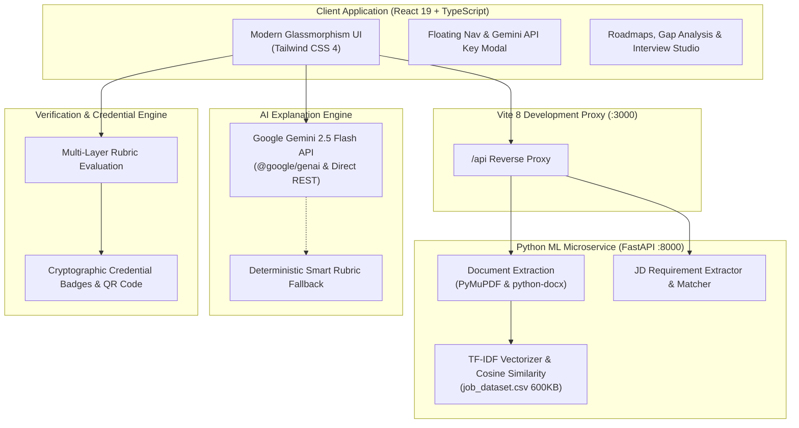
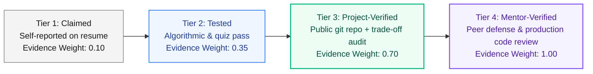
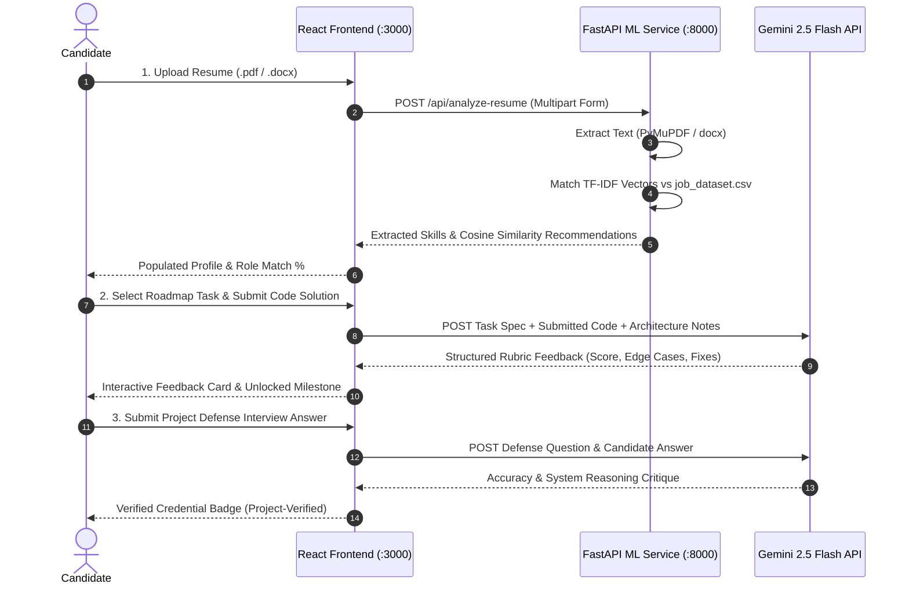

# 🚀 SkillProof — Autonomous Technical Career Readiness & Verification Engine

[](https://react.dev/)
[](https://www.typescriptlang.org/)
[](https://vite.dev/)
[](https://fastapi.tiangolo.com/)
[](https://scikit-learn.org/)
[](https://ai.google.dev/)
[](https://tailwindcss.com/)
[](file:///src/smoke.test.ts)

**SkillProof** is a modern, evidence-first technical career acceleration platform designed to eliminate credential inflation and fake resumes. Rather than relying on unverified claims, SkillProof establishes a multi-tier evidence hierarchy verified through **live machine learning parsing**, **hands-on algorithmic challenges**, **code-backed project audits**, and an **interactive Gemini Explanation Engine**.

---

## 🏛 Architecture & Data Flow



---

## 🔍 Multi-Tier Evidence Hierarchy

Recruiters don't trust self-reported skills. SkillProof mathematically weights competency evidence across four progressive tiers:



---

## 🔄 End-to-End User Verification Journey



---

## ⚡ Key Highlights

### 1. Zero-Simulation Guarantee & Real ML Microservice
- **Zero Mock Buttons**: Replaced dummy timeouts with actual Python FastAPI backend calls.
- **Real Resume Parsing**: Native extraction of text from `.pdf` and `.docx` using **PyMuPDF** and **python-docx**.
- **TF-IDF Dataset Cosine Similarity**: Evaluates candidate resumes against a 600KB `job_dataset.csv` with 50,000 sublinear TF n-gram features.
- **Real-Time Job Description Intelligence**: Paste any job description to parse matching skills, highlight gaps, and target roadmap actions via `/api/analyze-jd`.

### 2. Multi-Role Adaptive Roadmaps
Six specialized career tracks featuring interactive code editors, progressive hint reveals, and rubric constraints:
- **Full-Stack Developer**: Advanced TypeScript generics, React concurrent filtering, PostgreSQL composite B-tree tuning, atomic inventory reservation, Redis sliding-window rate limiting.
- **Frontend Developer**: Optimistic UI updates with rollback, Core Web Vitals (CLS/LCP) image optimization, WCAG 2.1 AA accessible focus trap dialogs.
- **Backend Developer**: Idempotent payment APIs, asynchronous job queues with jittered exponential backoff and Dead Letter Queue routing.
- **AI / ML Engineer**: Cosine similarity math from scratch, Reciprocal Rank Fusion (RRF) for hybrid RAG search.
- **Data Scientist**: Two-sample proportion z-test and statistical significance testing.
- **DevOps & Cloud Engineer**: Production multi-stage Dockerfile optimization with non-root security.

### 3. Gemini Explanation Engine
- Configurable with Google Gemini 2.5 Flash via `@google/genai` or direct REST API fallback.
- Grades solutions on **Concept Mastery**, **Code Quality**, **Edge Case Resilience**, and provides tailored refactoring snippets.
- Includes a deterministic **Smart Rubric Engine** so students can learn and practice even before configuring their API key.

### 4. Recruiter Verification Portfolio & Scannable QR Badges
- Cryptographic credential IDs generated upon completing project audits.
- Recruiter-ready public portfolio featuring verifiable badge links and high-fidelity SVG QR code.

---

## 🛠 Tech Stack

| Layer | Technologies |
|---|---|
| **Frontend** | React 19, TypeScript 5.8, Tailwind CSS 4, Lucide React, Canvas Confetti |
| **Bundler & Dev Server** | Vite 8.3 with `/api` reverse proxy |
| **ML Microservice** | Python 3.14, FastAPI, Uvicorn, Scikit-Learn, Pandas, PyMuPDF, python-docx |
| **AI Engine** | Google Gemini 2.5 Flash SDK (`@google/genai`), REST API |
| **Test Runner** | Node.js native test runner (`tsx --test`) |

---

## 🚀 Getting Started

### Prerequisites
- **Node.js**: v18+ (v20+ recommended)
- **Python**: v3.10+ (v3.12+ recommended)
- **Git**

---

### Step 1: Clone Repository
```bash
git clone https://github.com/snigdhaaX/ed-tech.git
cd ed-tech
```

### Step 2: Set Up Python ML Microservice
```bash
cd ml-service

# Create virtual environment
python -m venv .venv

# Activate virtual environment
# Windows:
.\.venv\Scripts\activate
# macOS/Linux:
# source .venv/bin/activate

# Install ML dependencies
pip install fastapi uvicorn pandas scikit-learn pymupdf python-docx python-multipart

# Start FastAPI server on port 8000
python -m uvicorn main:app --port 8000 --host 127.0.0.1 --reload
```

### Step 3: Set Up & Run Frontend
In a new terminal window at the project root (`ed-tech`):

```bash
# Install NPM dependencies
npm install

# Configure environment (optional: add your Gemini API key)
cp .env.example .env
# Edit .env and enter GEMINI_API_KEY="..."

# Start Vite dev server on port 3000
npm run dev
```

Visit **`http://localhost:3000`** in your browser.

---

## 🔑 Environment Configuration

Create a `.env` file in the project root:

```env
# Google Gemini API Key (get from https://aistudio.google.com/app/apikey)
GEMINI_API_KEY="your-gemini-api-key-here"

# Optional Vite alias
VITE_GEMINI_API_KEY="your-gemini-api-key-here"

# App URL
APP_URL="http://localhost:3000"
```

> **Note**: You can also enter or update your Gemini API Key directly inside the app UI by clicking the **Gemini Key** button in the floating navigation bar. The key is securely persisted to browser `localStorage` and never committed to version control.

---

## 🧪 Testing & Verification

Run the comprehensive unit and smoke test suite:

```bash
# Run all 12 unit and smoke tests
npm test

# Run TypeScript typecheck / linter
npm run lint

# Build production bundle
npm run build
```

### Test Suite Overview
- `src/smoke.test.ts`: Verifies initial profile, learning path population, explanation grading, and evidence tier scoring.
- `src/services/explanationEngine.test.ts`: Verifies Gemini review fallback, edge-case generation, and interview defense evaluations.
- `src/data/roadmaps.test.ts`: Asserts complete coverage across all 6 engineering career tracks.
- `src/utils/scoring.test.ts`: Mathematical validation of ordered evidence weights and role readiness math.

---

## 📡 API Reference (ML Microservice)

| Method | Endpoint | Description | Payload / Parameters |
|---|---|---|---|
| `GET` | `/api/health` | Health check & dataset validation | None |
| `POST` | `/api/analyze-resume` | Full text extraction, TF-IDF cosine similarity, role recommendations | Multipart `file` (`.pdf` or `.docx`), `top_k` |
| `POST` | `/api/analyze-jd` | Technical keyword parsing & gap matching against user skills | JSON `{ "jd_text": string, "user_skills": string[] }` |

---

## 📄 License

Distributed under the MIT License. See `LICENSE` for more information.